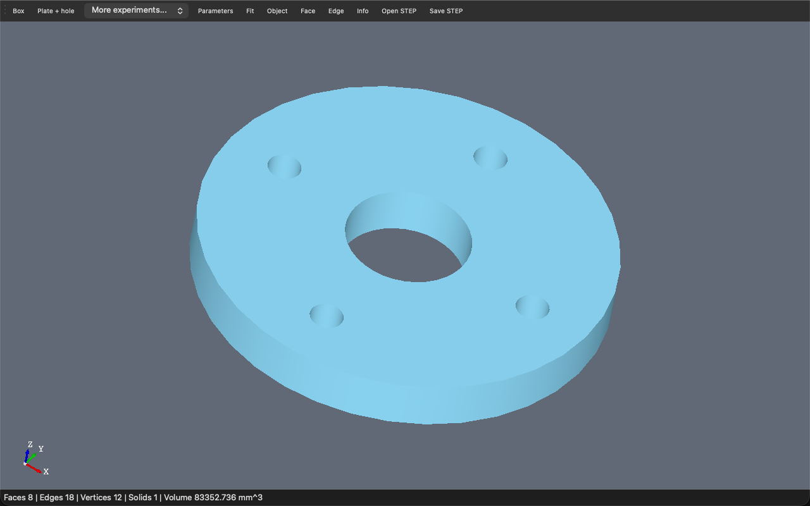
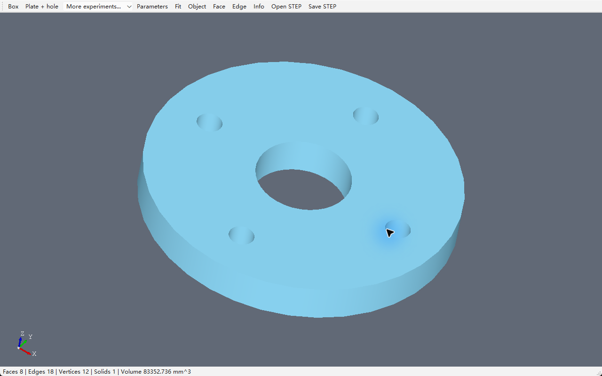

# 从零学习 Qt + Open CASCADE

面向有基础 C++ 经验、想入门 CAD 开发的读者：用同一套 **C++17 + Qt Widgets + Open CASCADE** 源码，从第一个三维窗口走到参数化法兰、拓扑拾取和 STEP 文件交换。支持 macOS 与 Windows，固定核心依赖为 **Qt 6.8.4 + OCCT 7.9.3**。

每个实验都有源码、运行方法和验收条件。建议先跑通工程，再按下方课程顺序阅读；无需先安装或学习完整 CAD 软件。





上图分别来自 macOS 与 Windows 的真实程序窗口。课程中的视口截图由 OCCT 从实际 OpenGL 帧缓冲导出，未使用生成式图像。

## 学习路线

| 顺序 | 教程 | 完成后能做什么 |
|---|---|---|
| 1 | [双平台安装与运行](docs/01-setup.md) | 编译工程并运行测试 |
| 2 | [基础概念与代码阅读](docs/02-foundations.md) | 分清几何、拓扑、显示对象 |
| 3 | [建模实验 01—10](docs/03-modeling-labs.md) | 基本体、布尔、拉伸、旋转、放样、圆角、法兰 |
| 4 | [交互与文件实验 11—18](docs/04-viewer-and-exchange.md) | 拾取、相机、STEP/BREP/STL |
| 5 | [测试覆盖、证据和 Windows 验收](docs/05-testing.md) | 判断实验是否真正通过 |
| 6 | [独立项目、架构与发布](docs/06-next-project.md) | 扩展参数化建模工具 |

## 获取工程

```bash
git clone https://github.com/13536309143/occt-qt-learning-lab.git
cd occt-qt-learning-lab
```

后续命令都在仓库根目录执行。依赖由 micromamba 安装到仓库的 `.local/`，不要求已有 Homebrew、Conda 或 Qt SDK。首次安装需要联网，除约数百 MB 的下载外，还要为依赖、包缓存和构建产物预留磁盘空间。

## macOS 快速开始

先安装 Xcode Command Line Tools：`xcode-select --install`。进入仓库后执行：

```bash
bash scripts/setup-macos.sh
bash scripts/build-macos.sh
open build-mac/OcctQtStarter.app
```

脚本使用本机架构：Apple Silicon 为 arm64，Intel 为 x86_64。`.local/` 与 `build-*` 不提交 Git。

## Windows 快速开始

准备 **Git for Windows**、**Visual Studio 2022 → 使用 C++ 的桌面开发**（含 MSVC x64 和 Windows SDK）。使用普通 Windows PowerShell 即可，脚本会自动加载编译器环境；无需预先打开 VS 开发者终端。

进入仓库后依次执行：

```powershell
powershell -ExecutionPolicy Bypass -File .\scripts\setup-windows.ps1
powershell -ExecutionPolicy Bypass -File .\scripts\build-windows.ps1
powershell -ExecutionPolicy Bypass -File .\scripts\run-windows.ps1
```

安装只需首次执行；修改源码后重新运行构建脚本即可。默认构建 Release，并执行模型与真实 OpenGL 窗口测试，测试期间会短暂弹出窗口，请在已登录的桌面会话运行。`ExecutionPolicy Bypass` 仅针对启动的这一个 PowerShell 进程。

没有桌面会话时使用 `build-windows.ps1 -SkipGui`，仅验证编译与模型。日常启动请使用 `run-windows.ps1`，它会设置本项目 DLL 的搜索路径。直接双击 EXE 可能缺少 Qt/OCCT 动态库。

详细安装、Qt Creator 配置、手动 SDK 路径及故障排查见 [安装教程](docs/01-setup.md)。不要混用 MSVC 与 MinGW 库，也不要把 Mac 构建目录复制到 Windows。

## 已验证的环境与结果

以下记录日期均为 **2026-11-24**，核心依赖均为 Qt 6.8.4 / OCCT 7.9.3。

| 环境 | 编译 / 模型检查 | 真实窗口检查 | 证据 |
|---|---|---|---|
| macOS arm64 / Apple Clang | Release，36/36 | 默认与强制 2 倍缩放各 18/18 | [Mac 结果](reports/macos-2026-11-24/gui-results.json) |
| Windows 11 x64 / MSVC 19.44 / RTX 3060 | Release，36/36 | 默认、强制 1.5 倍、2 倍缩放各 18/18 | [Windows 验证记录](reports/windows-2026-11-24/README.md) |
| GitHub Actions：Windows Server 2022 / macOS 15 | 两个平台编译及 36/36 模型检查通过 | CI 不运行桌面实验 | [CI 运行记录](https://github.com/13536309143/occt-qt-learning-lab/actions/runs/45338013646) |

Windows 另外通过原生文件对话框保存、打开中文文件名 STEP，核对长方体体积为 240000 mm³；取消导入后模型保留，关闭后可重新启动。本次修复了 Windows PowerShell 5.1 的 VS 路径引号、原生命令警告处理，以及 Qt 平台插件路径问题。

CTest 的 `2/2` 指两个套件，内部为 36 项模型检查和 18 项窗口检查。强制缩放是同一组实验的重复执行，不能替代不同物理显示器之间移动窗口的验收。覆盖范围与人工验收表见 [测试教程](docs/05-testing.md)。

本地运行后可查看：

```text
build-win/OcctQtStarter.exe                 Windows Release 程序（用运行脚本启动）
build-win/test-artifacts/model-results.json 模型检查结果
build-win/gui-artifacts/gui-results.json    窗口检查结果
build-win/gui-artifacts/*.png               真实渲染截图
reports/windows-local/                     配置、构建和 CTest 日志
```

## 界面操作

| 控件 / 输入 | 功能 |
|---|---|
| Box / Plate + hole | 长方体 / 带孔板 |
| More experiments | L 形拉伸、回转体、放样、圆角、法兰 |
| Parameters | 输入法兰参数并重建 |
| Fit | 适应视口 |
| Object / Face / Edge | 切换整件、面、边选择 |
| Info | 唯一拓扑数量与体积 |
| Open STEP / Save STEP | 替换当前模型 / 导出当前模型 |
| 左键 / Shift+左键 | 选择 / 切换多选 |
| 右键拖动 / 中键拖动 / 滚轮 | 旋转 / 平移 / 缩放 |

本教程约定 1 个建模单位 = 1 mm，导入导出也按毫米设置。当前应用是单模型教学工具；导入会替换当前模型。普通 STEP 形状接口不保存应用特征树、装配元数据和显示颜色。STL 是三角网格，不能等同于原始精确 BRep。

## 源码地图

```text
main.cpp                 Qt 工具栏、参数对话框、命令行入口
cad_view.h               视图生命周期、显示与鼠标事件
native_window.cpp        WNT_Window / Cocoa_Window 平台适配
modeling.h / .cpp        无 Qt 依赖的建模与文件交换
tests/model_tests.cpp    36 项可独立运行的模型检查
gui_experiments.cpp      18 项真实窗口实验与截图输出
scripts/                 Mac / Windows 安装、构建和运行
docs/                    中文课程与截图
samples/                 实际实验导出的 STEP、BREP、STL
reports/                 原始测试证据与环境锁定信息
.github/workflows/       Mac / Windows 自动编译与建模检查
```

测试代码使用 Qt Test 模拟事件；截图和几何数值来自实际 OCCT 执行结果。课程覆盖的是完整入门工作流，不宣称穷尽 OCCT 全部算法或全部输入情况。

## 官方资料和版本

- [OCCT 7.9.3 源码和离线文档](https://github.com/Open-Cascade-SAS/OCCT/releases/tag/V7_9_3)：推荐使用同版 overview-doc 和 refman-doc。
- [OCCT 官方文档入口](https://occt3d.com/dev/doc/overview/html/index.html)：在线版本可能比教程新。
- [Qt Widgets](https://doc.qt.io/qt-6/qtwidgets-index.html)。
- [Qt / OCCT 集成示例](https://github.com/gkv311/occt-samples-qt)：示例自述验证版本为 7.7，不应直接视作 8.x 项目。
- [8.x 升级说明](https://occt3d.com/dev/doc/overview/html/occt__upgrade.html)。

本仓库自编代码和课程使用 MIT；Qt、OCCT 和其他依赖遵循各自许可证，安装脚本不会改变这些依赖的授权条款。
