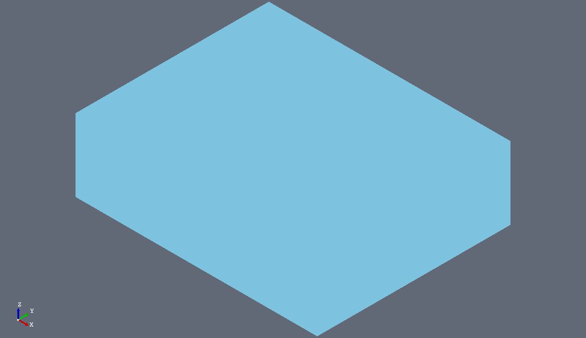
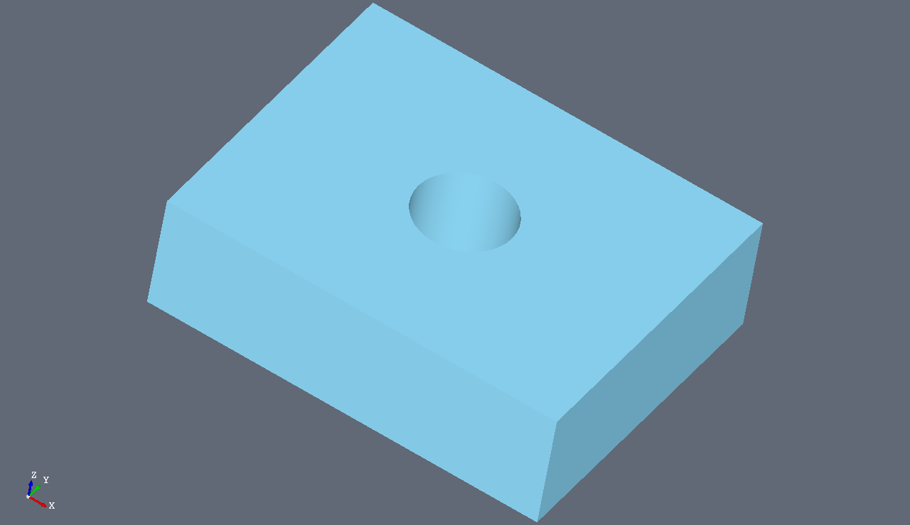
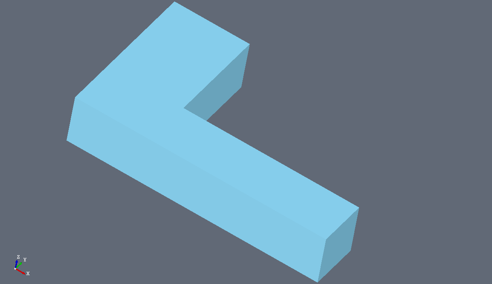
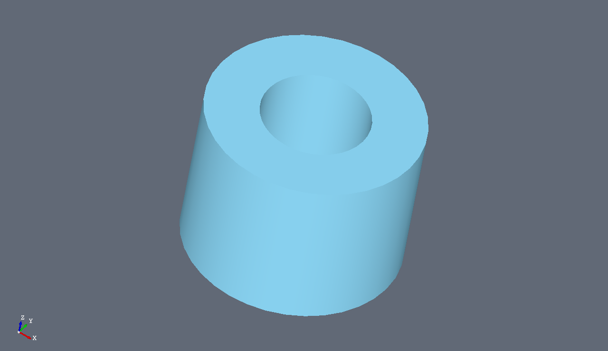
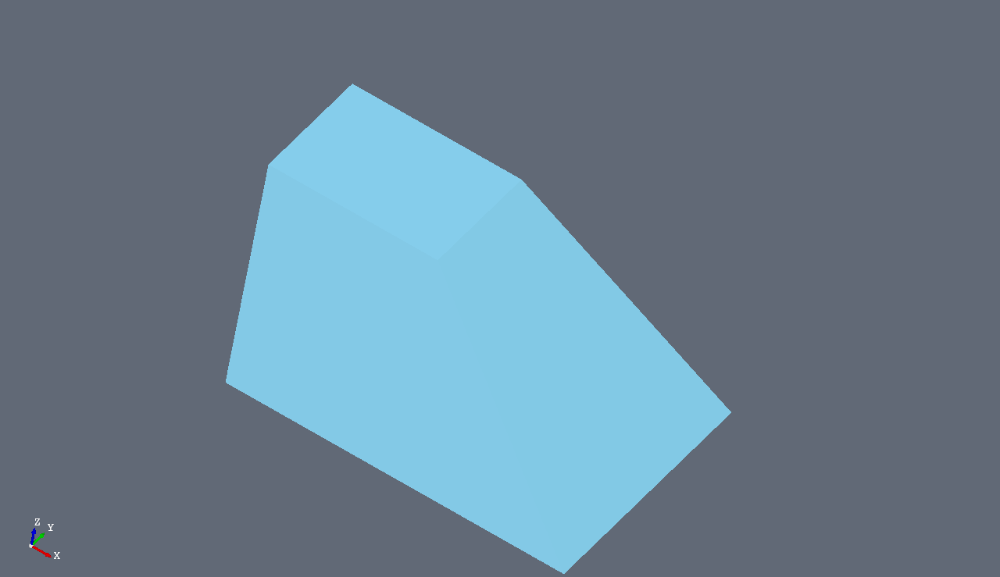
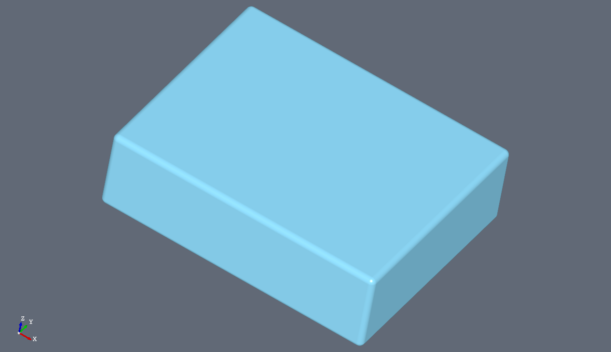
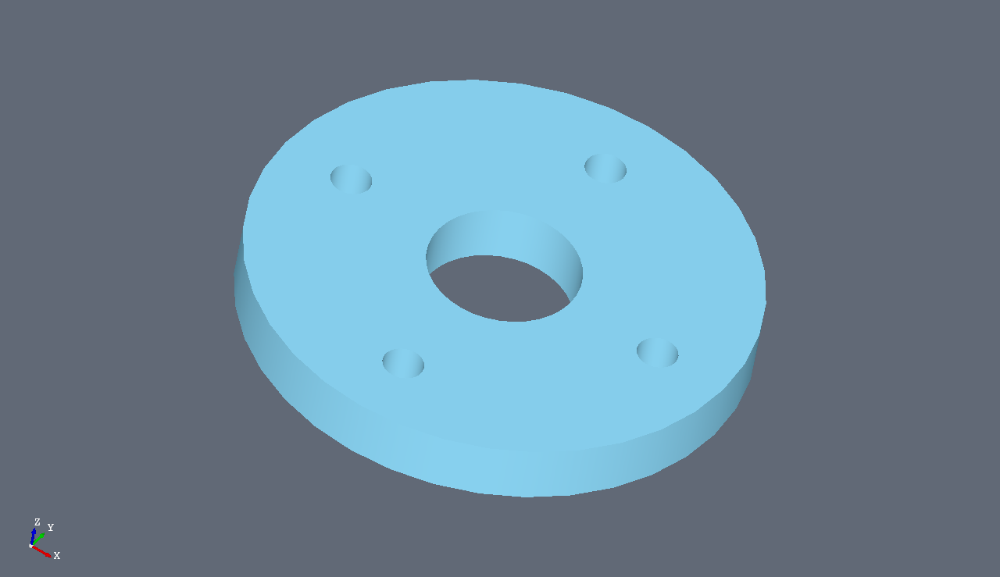

# 03：建模实验 01—10

所有函数实现在 [modeling.cpp](../modeling.cpp)，对应检查在 [model_tests.cpp](../tests/model_tests.cpp)。打开程序后，Box、Plate 和 More experiments 可直接查看模型。每次切换会替换当前模型。

## 实验 01：长方体、拓扑和体积

**目标**：创建 100×80×30 的实体，区分拓扑数量与显示三角形数量。

核心：`BRepPrimAPI_MakeBox` → Build → IsDone → Shape。

步骤：启动 → Box → Info；右键旋转观察六个面；切换 Face 后点击一个面。

预期：6 个唯一面、12 条唯一边、8 个唯一顶点、1 个实体；体积 240000 mm³；重心 (50,40,15)。用 `TopExp::MapShapes` 与 IndexedMap 避免把共享边重复计数。



修改：把 cad::box 的调用改成 `cad::box(2,3,4)`，预期体积 24。回退修改后再进行后续实验。

检查：box_topology、box_volume、box_center、box_custom_dimensions。

## 实验 02：球体与基本体属性

**目标**：熟悉不同基本体和数值验收。

测试代码创建半径 10 的球，期望体积 `4πr³/3 ≈ 4188.790205`。把球临时传给 displayShape，即可显示。

练习：比较球体的显示网格与底层球面。放大后看到的三角形不表示模型已变成 STL。

检查：sphere_volume。

## 实验 03：贯穿孔与差集

**目标**：从板件减掉半径 12 的圆柱。

步骤：Plate + hole → Info → 旋转观察孔壁。

工具体中心 XY=(50,40)，从 Z=-5 延伸到 35，板件 Z 范围是 0—30。工具体明确穿过板件，避免首次练习陷入端面恰好重合的边界情况。

```cpp
BRepAlgoAPI_Cut op(base, tool);
op.Build();
if (!op.IsDone()) throw std::runtime_error("Boolean failed");
cad::requireValid(op.Shape());
```

预期体积：`240000 − π×12²×30 ≈ 226428.319737 mm³`；1 个实体、7 个面。



负例：半径 40 被应用参数规则拒绝。这里是课程对“板内完整孔”的限制，不是宣称 OCCT 不能做边界开槽。

检查：plate_volume、plate_single_solid、reject_oversized_plate_hole。

## 实验 04：并集与交集

**目标**：验证布尔运算的体积意义。

创建两个 10×10×10 的立方体，把第二个沿 X 平移 5。

| 操作 | 类 | 期望体积 |
|---|---|---:|
| 并集 | BRepAlgoAPI_Fuse | 1500 |
| 交集 | BRepAlgoAPI_Common | 500 |
| 从 A 减去 B（练习） | BRepAlgoAPI_Cut | 500 |

不要用“屏幕上看起来重叠”判断两物体在三维空间中是否相交。用位置信息和体积检查。

检查：boolean_union_volume、boolean_intersection_volume。

## 实验 05：闭合轮廓到 L 形拉伸

**目标**：掌握 点 → 线框 → 面 → 实体。

轮廓点依次为 (0,0)、(100,0)、(100,20)、(30,20)、(30,60)、(0,60)，所有 Z=0；Close 后建面，再沿 Z 拉伸 20。

```cpp
BRepBuilderAPI_MakeFace face(profileWire);
BRepPrimAPI_MakePrism prism(face.Face(), gp_Vec(0,0,20));
```

步骤：More experiments → L extrusion；确认缺口方向；Info 查看体积。

面积 `100×20 + 30×40 = 3200`，体积 `3200×20 = 64000 mm³`。



练习：把高度改成 10，预期体积 32000。故意将轮廓一点的 Z 改成 10，观察建面失败或几何变化；不要将任意不共面线框当作平面轮廓。

检查：extrusion_volume、reject_zero_extrusion。

## 实验 06：绕轴回转

**目标**：从截面生成回转体。

在 XZ 平面建立矩形：X=10—20，Z=0—30，绕全局 Z 轴旋转一周。结果是外半径 20、内半径 10、高 30 的圆管。

步骤：More experiments → Revolution；观察内外圆柱面。

体积 `π×(20²−10²)×30 = 9000π ≈ 28274.333882 mm³`。



练习：截面移到旋转轴上，比较实心圆柱和圆管。对部分回转，角度使用弧度，180 度为 π。

检查：revolution_volume。

## 实验 07：两个截面的实体放样

**目标**：认识 BRepOffsetAPI_ThruSections。

底部矩形为 80×60，Z=0；顶部矩形为 40×30，Z=60。使用相同边顺序，要求生成 Solid。

步骤：More experiments → Loft；检查上下端封闭和四个侧面。

体积可以按相似截面棱台公式复核：`60/3 × (4800+1200+√(4800×1200)) = 168000 mm³`。



练习：让上下截面的顶点顺序不一致，理解为什么截面对齐会影响放样。高级练习再研究多截面、样条连续性和 CheckCompatibility。

检查：loft_volume。

## 实验 08：圆角

**目标**：圆角不是简单地给边设置一个显示属性。

对长方体的唯一边集合逐条 `Add(2.0, edge)`，执行 BRepFilletAPI_MakeFillet。

步骤：More experiments → Fillet；放大观察转角，再 Info 查看体积。

预期：模型合法、仍为一个实体，体积小于 240000。曲面圆角使面数变化，因此不要沿用长方体的 6 面验收。



练习：只对鼠标选中的边做圆角。必须使用当前模型的边；替换模型后旧边不应继续拿来操作新模型。课程限制半径小于最小边长的一半，避免首次练习使用明显不合适的尺寸。

检查：fillet_valid_and_removes_material、reject_oversized_fillet。

## 实验 09：变换与模型坐标

**目标**：区分相机旋转和模型变换。

把长方体平移 (120,-30,40)。体积保持 240000，重心变为 (170,10,55)。

```cpp
gp_Trsf t;
t.SetTranslation(gp_Vec(120,-30,40));
BRepBuilderAPI_Transform op(shape,t,true);
```

练习：用 SetRotation 绕 Z 轴旋转 π/2。用重心坐标验证结果；不要只旋转相机后就说模型已变换。

检查：translation_volume、translation_center、reject_invalid_translation。

## 实验 10：参数化法兰

**目标**：把基本体、布尔、循环、输入校验和 Qt 参数界面连接起来。

默认外径 100，厚度 12，中心孔径 30，4 个孔径 8 的螺栓孔，分布圆直径 70。

孔中心：`x=35cos(2πi/N)`，`y=35sin(2πi/N)`。

步骤：More experiments → Flange；Parameters → 修改孔数为 6 → OK；Info 检查体积；导出 STEP。

默认体积 `π×(50²−15²−4×4²)×12 ≈ 83352.736282 mm³`。六孔时换成 `6×4²`。



需要拒绝：非正尺寸、中心孔越界、孔数为零、螺栓孔越过内外边界、相邻孔相交。本工程要求孔之间保留正间隙；参数验证在建模前执行。

检查：flange_volume、flange_six_holes、reject_invalid_flange_count、reject_overlapping_flange_holes。

练习成果：自己添加一个“外缘圆角”参数，并对体积减少、合法性和错误输入增加检查。不要仅复制一遍实现来写测试；优先使用独立的数学预期或模型不变量。
