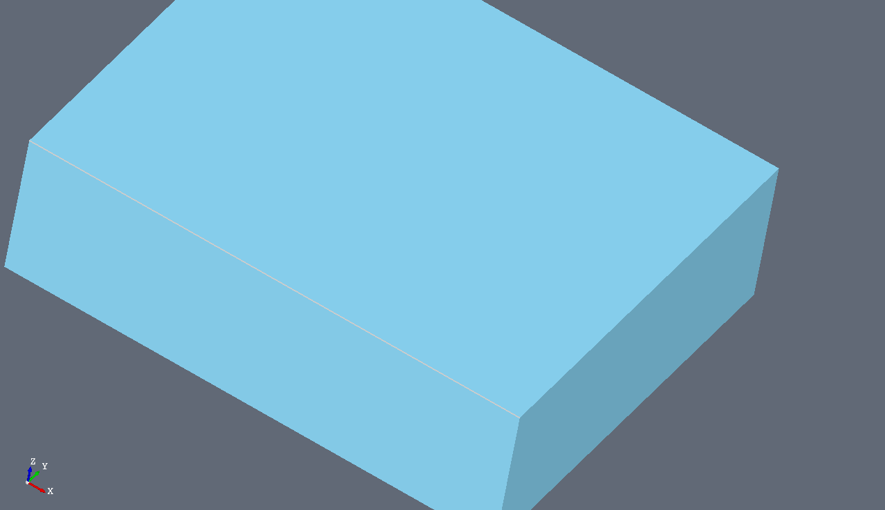
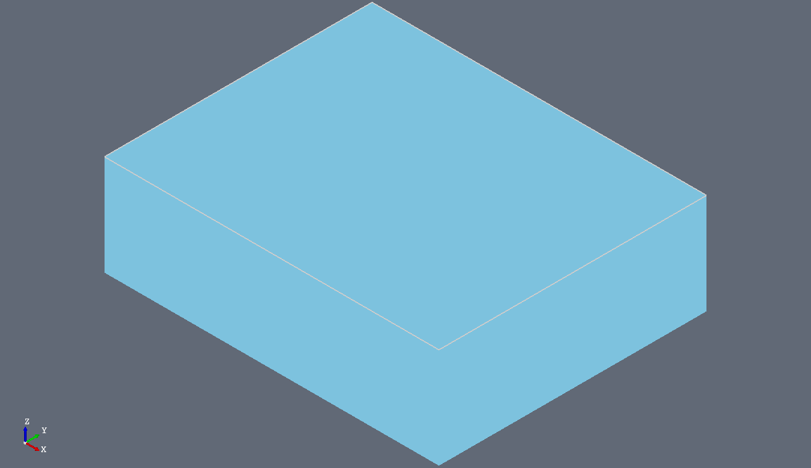
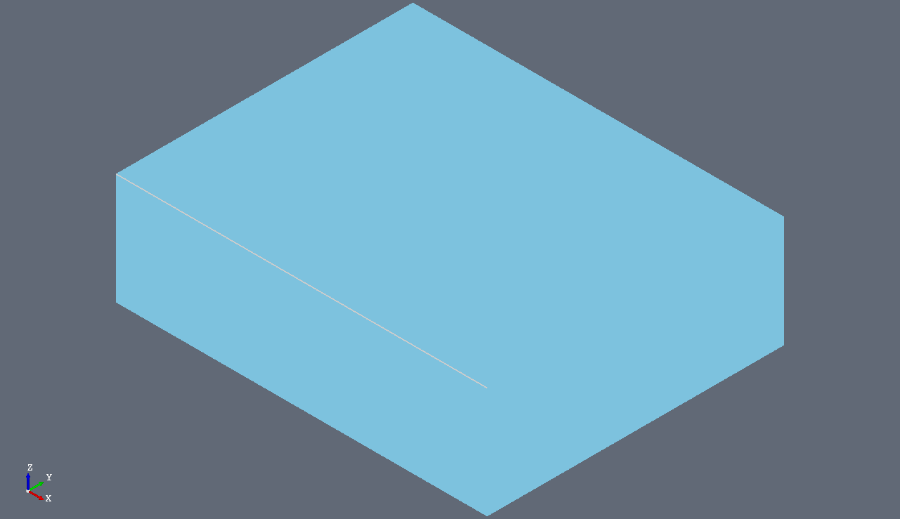
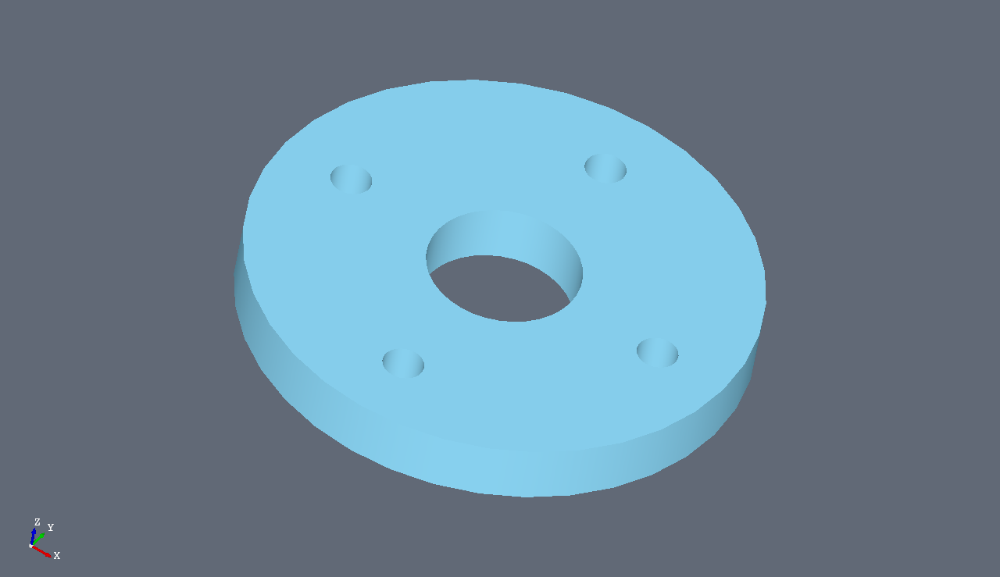

# 04：窗口、交互和文件实验 11—18

## 实验 11：接入原生 Qt 窗口

**源码**：cad_view.h / native_window.cpp。

初始化顺序：DisplayConnection → OpenGl_GraphicDriver → V3d_Viewer → 灯光 → Context → View → SetWindow → 显示模型。

Qt winId 提供平台窗口句柄。Windows 用 WNT_Window 包装，Mac 用 Cocoa_Window 包装 NSView；几何模型不需要为平台分别编写。

本工程使用 QWidget 并重写 paintEngine，OCCT 自己管理 OpenGL。不要直接加入 QPainter 在三维控件上画半透明 UI。后续可研究 QOpenGLWidget，但必须处理共享上下文和 FBO，不能只替换父类。

验收：窗口首次出现就有长方体；拖动尺寸后画面有效；关闭时正常退出。原始 GUI 检查 native_window_opengl_initialization / resize_and_fit 已覆盖这些路径的一部分，跨显卡和休眠恢复需人工另测。

## 实验 12：着色显示与更新

TopoDS_Shape 是模型，AIS_Shape 是显示对象，Context 管理它。`Display(object,false)` 后集中刷新，避免批量操作时每一步都重绘。

修改已有对象时，`SetShape` 后应 `Redisplay`；本教学程序简单地移除旧对象再显示新对象。AIS 颜色变化不等同于修改 CAD 文件的材料或颜色元数据。

步骤：Box、Plate 和每个 More experiments 项目依次切换。应只有当前模型，不能残留上一件的选择高亮。

## 实验 13：鼠标旋转、平移和缩放

右键按下时 StartRotation，移动时 Rotation；中键拖动时按坐标差 Pan；滚轮以系数 SetZoom。相机变化不改变体积。

GUI 自动实验向实际 QWidget 分发鼠标和滚轮事件，并读取 Camera 的方向、中心、Scale 验证变化，不只检查函数是否返回。

人工步骤：旋转 → 平移 → 缩放 → Fit → Info，模型应仍完整、体积不变。Mac 触控板的旋转手势不在本例内；使用三键鼠标完成课程。

## 实验 14：面、边和多选

MoveTo 是检测鼠标下对象，SelectDetected 才是修改选择集。Face / Edge 按钮停用旧模式，再激活 AIS_Shape::SelectionMode 对应的拓扑模式。

步骤：Box → Face → 点击顶面；然后 Edge → 点击前上方一条边。状态栏类型应分别是 FACE=4、EDGE=6。

自动实验先将已知世界坐标投影到视口，再模拟点击，验证选择结果确实是 Face/Edge。人工还需检查 Shift+左键多选、空白处点击、快速切换模式和窗口跨屏移动。

Qt 的逻辑坐标和 OCCT 窗口坐标不总相同。这里按 Aspect_Window::Size 与 QWidget 大小换算；不要无条件在 Mac 和 Windows 都乘 devicePixelRatio。

## 实验 15：STEP 往返与单位

步骤：Flange → Info → Save STEP → 保存 → Box → Open STEP 重新打开；比较体积、孔数和外观。

ReadFile 后检查状态；TransferRoots 后检查可转移根；OneShape 后检查非空和 BRep 合法性。写入时检查 Transfer 和 Write 两次状态。

本工程设置 `write.step.unit=MM` 和导入目标单位 `xstep.cascade.unit=MM`。尺寸校验仍必不可少；遇到第三方文件应使用已知尺寸确认结果。

自动检查包括：体积往返、实体数、中文文件名、文件不存在、损坏文件、目标目录不存在；损坏输入时预期测试日志包含 OCCT 错误消息，测试本身应通过。

已验证的 Unicode 文件名只代表该次执行环境。Windows 上同一检查仍应实跑，不能从 Mac 推断成功。

普通 STEPControl 只用于形状交换。需要装配树、颜色和名称时研究 STEPCAFControl/XDE；它也不会自动还原原 CAD 软件的参数化特征历史。

## 实验 16：BREP 与 STL

cad::writeBrep/readBrep 用 BRepTools 保存 OCCT 形状，自动检查体积往返。

cad::writeStl 先 BRepMesh_IncrementalMesh，再 StlAPI_Writer 输出二进制网格。检查 STL 三角形计数大于零，并按二进制格式验证文件长度 `84+50×triangleCount`。

示例结果在 samples/。BREP 保存几何拓扑；STL 只保存三角网格。当前 STL 测试检查文件结构，不等同于对网格水密性、法向、细分误差的完整认证。

练习：修改网格线性偏差参数，比较三角形数与文件大小。数值越小通常网格越细，但速度和大小也会变化。

## 实验 17：失败不丢失旧模型

displayShape 先校验候选形状，再删除旧显示。Parameters 的新模型构建也在替换前完成。

步骤：创建有效法兰，记录体积，再输入明显不合法的参数，关闭错误提示后应仍显示原模型。

自动检查向 displayShape 传入空形状并确认旧模型保留；自动实验还会打开参数对话框、设置六孔并点击 OK 验证重建体积；不合法参数的提示与取消路径仍需人工验收。

改进练习：添加日志区域，区分“参数不合理”“算法失败”“文件错误”，并把详细原因保存下来。

## 实验 18：重绘、截图与证据

运行 `--self-test --output <目录>` 会执行窗口实验并输出 PNG 和 JSON。PNG 01—12 和 14 来自实际 OCCT 视口 Dump；PNG 13 来自系统抓取的本应用窗口区域。系统可能限制屏幕抓取，因此 13 是可选证据，不能用它是否存在来替代渲染检查。

截图检查包含尺寸与非背景像素检查，还需要人工查看孔、圆角、面选择是否合理。不能仅凭“生成了 PNG”认定渲染正确。

本次本机窗口截图已经人工查看。强制高 DPI 的结果、实际运行版本和未覆盖项目见测试报告。
